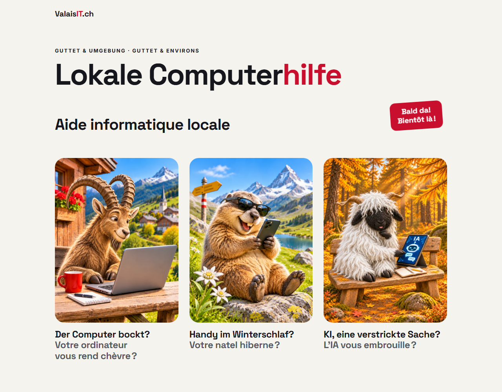

# valaisit.ch

One-page site for [ValaisIT.ch](https://valaisit.ch) — local help with computers, phones and AI in Guttet (Valais, Switzerland) and the surrounding villages, by Philippe Noth.

Static, bilingual (DE / FR), no framework, no build step. Pure HTML and CSS, a few lines of vanilla JavaScript, and one small PHP script for the contact form.

## Screenshots

<p align="center">
  
</p>

<p align="center">
  
  &nbsp;&nbsp;
  
</p>

## Design

Light and friendly, taken from the printed notice that hangs in the village shop: paper-coloured background `#F5F3EE`, near-black ink `#16171D`, and Valais red `#C8102E` for the accent and the tilted "first diagnosis free" sticker. Space Grotesk for headlines, Inter for body text.

Three alpine characters carry the three services, each with its own pun in both languages:

- the **ibex** at a laptop — computers
- the **marmot** with a smartphone — phones
- the **Valais Blacknose sheep** with a tablet — an introduction to AI

Below 760 px each character card is a row (picture left, text right); from 760 px up they sit in three columns.

## Structure

```
/
├── index.html         # Fallback redirect (browser language → de/ or fr/)
├── coming-soon.html   # Bilingual teaser, shown while the service is not open
├── .htaccess          # Coming-soon mode, language redirect, 404
├── 404.html
├── contact.php        # Contact form handler (sends an e-mail)
├── assets/            # Favicon
├── css/style.css      # Single stylesheet, design tokens at the top
├── js/script.js       # Sends the form in the background
├── images/            # Ibex, marmot, sheep, Open Graph image
├── de/  fr/           # One folder per language, mirrored content
└── docs/
    └── screenshots/   # Screenshots for this README
```

Text changes must be made in both `de/index.html` and `fr/index.html`.

## Coming-soon mode

While the service is not open yet, the block marked `COMING SOON MODE` at the top of `.htaccess` shows `coming-soon.html` at the root address and sends every other page back to it. Delete that block to open the full site.

## Running locally

```powershell
php -S localhost:8123
```

Then open <http://localhost:8123>, or <http://localhost:8123/coming-soon.html> for the teaser. PHP's built-in server ignores `.htaccess`, so the coming-soon mode is not active locally. The contact form needs a mail server, so locally it shows its error message.

## Deploying

Copy the contents of this repository to the web root of an Apache host with PHP.
